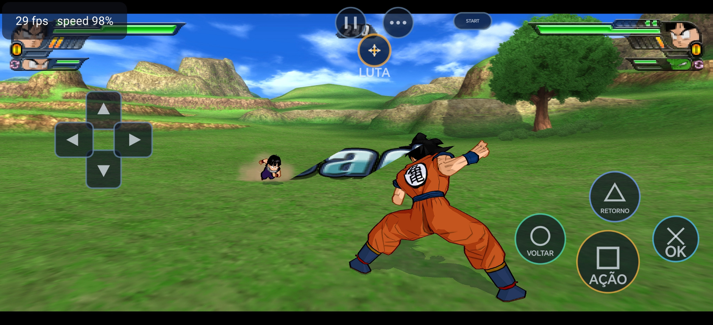
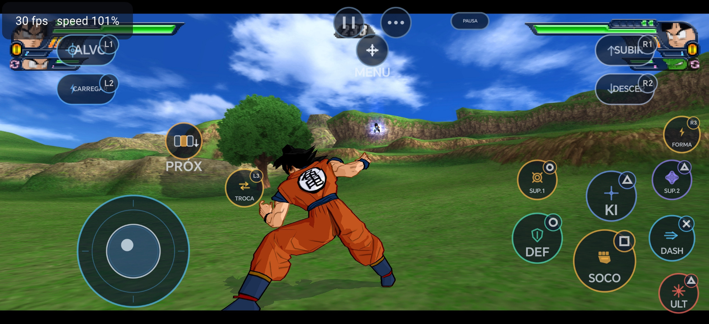

# Dragon Rage 0.3.0

This release focuses on a more mobile-friendly, game-specific touch experience for the Android port of Dragon Ball Z: Budokai Tenkaichi 3.

## Highlights

### Redesigned touch controls

- Reworked the on-screen controller around in-game actions instead of presenting only a generic console gamepad.
- Added action-oriented controls for target lock, Ki charging, melee attacks, guard, dash, Ki attacks, super techniques, ultimate attacks, flight, transformation, and team-battle actions.
- Added a dedicated **Menu** control layout with a digital D-pad and touch actions for confirm/back, plus a **MENU/FIGHT** mode switch.
- Kept pause, options, Start/Select, and other utility controls available to be positioned in the layout editor.

### Personalization and layout editing

- Controls can be moved and resized independently and their opacity can be adjusted.
- Added PlayStation, Xbox, and Nintendo button-hint skins. Changing the skin changes the small button labels while retaining the action-oriented control design.
- Added reset and hide options in the layout editor, and retained access to hidden controls so they can be restored or repositioned.
- Adjusted the editor toolbar and safe-area handling to reduce overlap with controls and improve placement around device screen cutouts.

### Team-battle controls

- Added on-screen **PRÓX.** and **TROCAR** actions for team battles, including the intended combined L3+R3 swap input.
- The controls are designed to be conditional on the selected team size. Team switching and roster detection should still be validated across Team Battle/DP Battle configurations and different devices before being considered universally verified.

## Screenshots

### Menu navigation layout

The menu-oriented touch layout uses a digital D-pad and explicit confirm/back actions, so navigation does not depend on an analog stick.

### Combat layout

The combat layout exposes game-specific actions while keeping the main movement and attack controls reachable by touch.

## Performance and compatibility

- This release focuses on the Android touch interface and its layout editor. It does **not** include a broad rewrite of the Vulkan renderer or Mali/Adreno-specific graphics paths.
- Performance profiling is still ongoing. Additional rendering optimizations should be introduced separately and measured on more than one GPU family to reduce the risk of regressions on unsupported or untested devices.

## Not included yet

- **Android online multiplayer is not implemented in this release.** The menu entry may be present, but the online flow still needs implementation and testing. Work on bringing online mode to Android is planned for the next development cycle.

## Upgrade notes

- This is a testing-sensitive update. Validate touch navigation, combat inputs, team switching, and the layout editor on the target device before treating every control combination as verified.
- The app still requires the user's own compatible game disc image; this release does not distribute game data.
